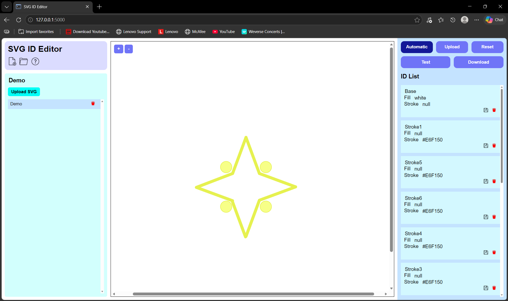

# SVG ID Editor ✏️

## Overview
    

Version 2.0.0 aims to provide a proper UI for the tool as well as introduce a new features. The core component from version 1.0.0 remains the same. This project utilizes HTML5, JavaScript and CSS for the frontend with Python as the backend and Flask as the framework.

## Preview

## Features
### 1. File Management
- Create new project
- Open existing project

### 2. Project Management
- Upload SVG file to work with in the project
- Rename project

### 3. SVG Preview
- Preview the SVG
- Zoom in / zoom out the select SVG

### 4. SVG Processing
- Automatic ID
- Upload ID > core component from Version 1.0.0
- Reset
- Test > Preview component that has been ID by highlighting.
- Download > Download the SVG